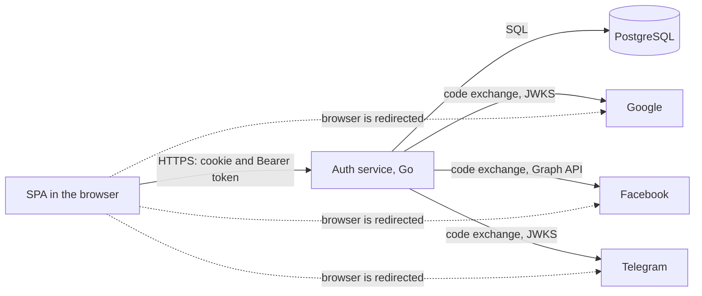
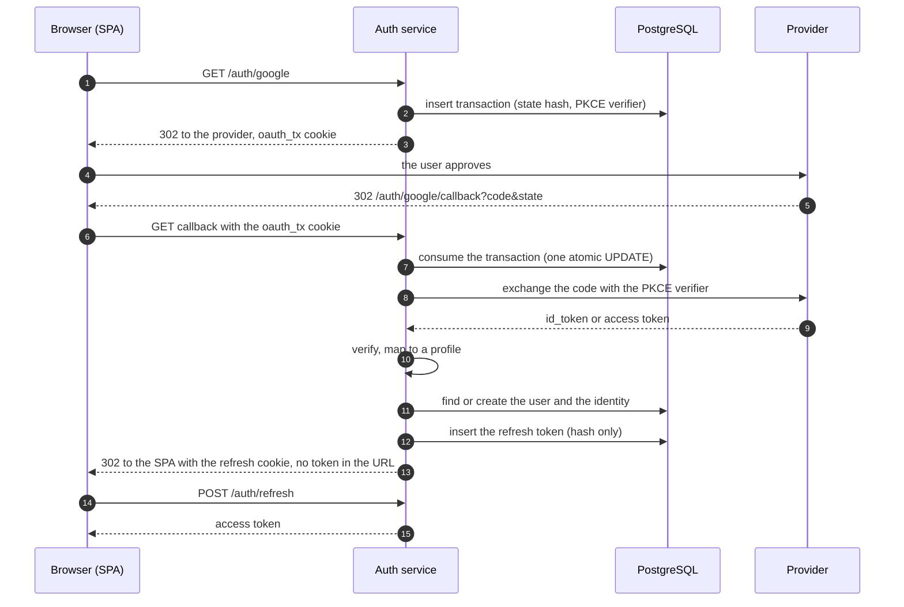
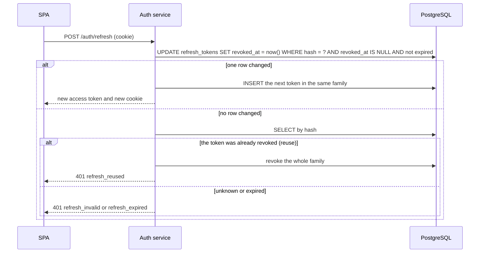
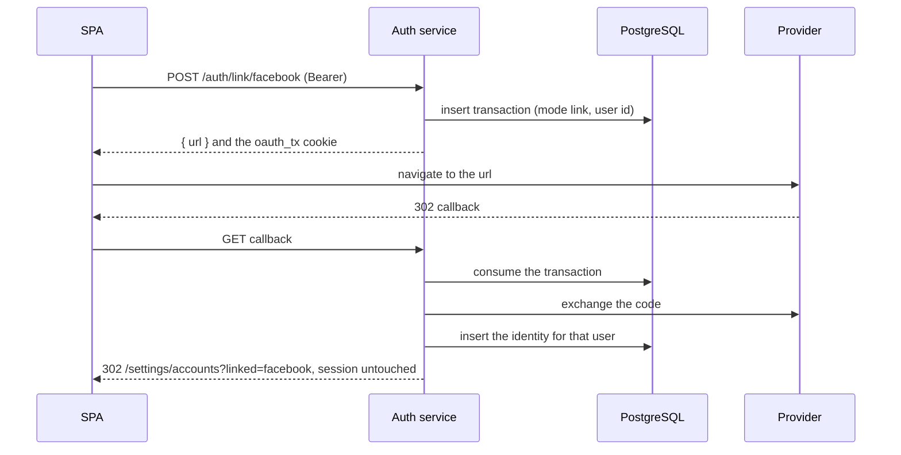

# Architecture

How the service is built and why. The database is described in [DATABASE.md](DATABASE.md), the threats in [SECURITY.md](SECURITY.md), and the tests in [TESTING.md](TESTING.md).

## The problem

The ticket: add OAuth login with Google, Facebook and Telegram. It was first built in NestJS ([alifco-auth](https://github.com/iskanderovv/alifco-auth)) and then rewritten in Go, which is this repository. The design was written to survive a rewrite, and this is the proof: the schema, the endpoints, the token rules and the error codes are identical.

| | |
|---|---|
| In scope | sign in and sign up with the three providers, sessions, `/me`, refresh, logout |
| Added on my own initiative | explicit account linking and unlinking (the ticket did not ask for it) |
| Out of scope | password login, roles, account deletion or merging, admin tools, cleanup jobs |

Assumptions that shaped the design, and what happened to each:

| Assumption | Outcome |
|---|---|
| The SPA and the API are on one site (subdomains of one domain) | Kept and confirmed. The cookie settings depend on it |
| There is no existing users table | Confirmed. The service owns `users` |
| I create the provider apps myself | Confirmed. All three apps exist and were used with real accounts |
| Telegram is "OAuth like the others" | Wrong. Its old login widget is archived and uses a different scheme. I switched to its OpenID Connect flow after reading the current documentation |
| One person can be recognised across providers by email | Rejected. Only Google proves an email. Matching on the others lets an attacker take over an account (see [SECURITY.md](SECURITY.md)) |

## System context



## Components

| Package | Responsibility |
|---|---|
| `cmd/server` | Wiring only: load the config, open the pool, build the services, serve, shut down gracefully |
| `internal/httpapi` | Routes, middleware (recover, access log, CORS, body limit, rate limit, CSRF, bearer check) and the handlers. Callbacks always answer with a redirect |
| `internal/provider` | One adapter per provider behind the `Provider` interface, and a registry that builds the adapters whose credentials are set. A provider without credentials does not exist |
| `internal/provider/oidc.go` | Token request, `id_token` checks and the JWKS cache shared by Google and Telegram. Facebook is plain OAuth 2 and reads the Graph API, every call signed with `appsecret_proof` |
| `internal/oauthtx` | One row per started flow: hashed `state`, PKCE verifier, mode, single use |
| `internal/identity` | Find or create a user, link, unlink. The only place that decides who an account belongs to |
| `internal/token` | Access JWT and refresh token rotation |
| `internal/store` | SQL over pgx, one small method per query |
| `internal/apperr` | The one error type that reaches the client. Every error leaves as `{ "error": { "code", "message" } }` |
| `internal/config` | Validates all configuration at startup and names every bad variable without printing its value |
| `internal/db` | The pool and the goose migrations, embedded in the binary |

A new provider is one type that implements `provider.Provider` plus one block in the registry. The handlers and `identity` know nothing about individual providers.

## Flows

### Login



The SPA never receives a token in a URL. After the redirect it calls `/auth/refresh`, and the httpOnly cookie that the browser sends automatically turns into an access token held in memory.

### Refresh rotation



The conditional `UPDATE` is the whole concurrency story: of two requests carrying the same token, the database lets exactly one change the row. The loser sees a revoked token, which is treated as theft and kills the family. A test fires 100 parallel refreshes of one token and requires exactly one success.

### Linking another provider



A browser navigation cannot carry an `Authorization` header, which is why linking starts with a `fetch` that returns the provider URL instead of being a plain redirect. The unique indexes decide conflicts: an account that already belongs to another user is refused with `identity_taken`.

## Session model

| | Access token | Refresh token |
|---|---|---|
| Form | HS256 JWT with `sub`, `iss`, `aud`, `iat`, `exp` only | 32 random bytes, opaque |
| Lifetime | 15 minutes | 30 days, renewed on every rotation |
| Where it lives | the SPA's memory | httpOnly, host-only, `SameSite=Lax` cookie on path `/auth` |
| Stored on the server | nothing | SHA-256 hash only |
| Revocable | no, it expires quickly | yes, by family |

The access token carries no email or roles on purpose: profile data comes from `/me`, so nothing in the token can go stale.

## Decisions

Each row is a choice where there was a real alternative.

| # | Decision | Alternatives considered | Why | Cost |
|---|---|---|---|---|
| 1 | Go with the standard library, `chi` for routing | Gin, Echo, Fiber | `net/http` handlers compose with plain middleware and need no framework types. `chi` adds only path parameters and groups | Slightly more wiring by hand |
| 2 | `pgx` with handwritten SQL, one small method per query | `sqlc`, GORM | The concurrency rules (conditional `UPDATE`, `FOR UPDATE`, unique index) must be visible next to the code that relies on them. With four tables and about fifteen queries, code generation adds a build step and hides little | No compile-time check of the SQL, covered by tests against a real database |
| 3 | Own `Provider` interface, one adapter per provider | An OAuth library per provider | The three flows differ (OIDC with two client authentication styles, plain OAuth 2 with a Graph API). Adapters are small and testable with fakes | I wrote the three flows myself |
| 4 | `users` plus `oauth_identities`, keyed by `(provider, provider_user_id)` | One users table with a column per provider; matching by email | A person can have several providers and the key is the one thing a provider guarantees is stable | One more join |
| 5 | Never match accounts by email | Auto-link on equal email | Facebook and Telegram do not prove an email. Matching on it allows pre-registration takeover | A person who signed in with two providers separately has two profiles, and linking is explicit |
| 6 | Short access JWT plus rotating refresh token | Server sessions in Redis; one long-lived JWT | No session store to run, and a stolen refresh token is detected on its next use | Rotation needs the SPA to send refresh calls one at a time |
| 7 | Refresh tokens stored as SHA-256, rotated with one conditional `UPDATE ... RETURNING`, reuse revokes the family | Bcrypt; a grace window for two tabs | The tokens are 256 bits of randomness, so a fast hash is correct. A grace window cannot work with hash-only storage | Two tabs refreshing at once log the user out |
| 8 | OAuth `state` and the PKCE verifier in a database table, consumed by one `UPDATE ... RETURNING` | A signed cookie; Redis | A signed cookie cannot be made single use. The database is already there | One small table that is never cleaned up |
| 9 | PKCE (S256) on every provider | `state` alone | The code is useless without the verifier, even if it leaks | None |
| 10 | Telegram through OpenID Connect | The Login Widget with the HMAC hash check | The widget is archived. OIDC is the same shape as Google | Telegram only accepts https redirect URIs |
| 11 | `golang-jwt` for our token and for `id_token`s, with my own small JWKS cache | A JOSE library for everything | Two call sites, one algorithm each, pinned. The cache is about sixty lines, and reading the key response with `net/http` decompresses gzip, which Telegram sends even when none is asked for | I maintain the cache, and a test covers it |
| 12 | Linking is explicit, unlink locks the user row | Merging profiles | Merging needs both sides to consent and moves data. Locking stops two concurrent unlinks from removing every sign-in method | No merge, documented as a limit |
| 13 | Cookies host-only, `Lax`, path `/auth`, plus a custom header and an `Origin` check on refresh and logout | `SameSite=None`; tokens in the response body | The SPA and API share a site, so the strictest cookie works. The header forces a CORS preflight that a cross-site form cannot satisfy | Breaks if the two ever move to different sites |
| 14 | Callbacks always redirect, with an error code from a fixed list | JSON errors | A callback is a browser navigation, not an API call. Provider messages never reach a URL | The SPA needs a callback page |
| 15 | Environment validated once at startup, providers optional | Reading `os.Getenv` where needed | The service refuses to start with a bad value, naming it, and runs with only some providers configured | None |
| 16 | No cookie secret | A signed `oauth_tx` cookie | The cookie holds only a row id. The row is bound to the hashed `state`, so a forged or guessed id is useless, and there is one secret less to manage | None |
| 17 | Tests against a real PostgreSQL, one throwaway schema per test, fake providers | Mocking the store | The guarantees that matter (atomic update, unique indexes, row locks) are database behaviour that a mock cannot show | A database is needed to run the tests |
| 18 | Logs carry no headers, cookies or query strings | Default request logging | Tokens, the OAuth `code` and `state` all travel in those places | Less detail per request |
| 19 | The OpenAPI document is a hand-written JSON file, tested for the routes it must list | Generating it from annotations | One source of truth, no code generation step, and a test fails when a route is missing | It can drift from the handlers on parameters and schemas |
| 20 | The dev SPA is embedded in the binary and served on the same origin | A separate dev server and proxy | One https tunnel serves everything, which is what a demo needs | Development convenience only, switched on with `DEV_SPA=true` |
| 21 | Packages split by responsibility (`token`, `identity`, `provider`, `store`, `httpapi`), not by layer (`handler`, `service`, `repository`, `model`) | The layered layout | Layer packages such as `model` and `service` pull every feature into one place and invite import cycles. Here a package owns one rule and its tests, and dependencies run one way, from `httpapi` to the services to `store`. `pkg/` is not used: nothing here is meant to be imported by other projects | A reader used to layers has to learn the names once. The mapping is `httpapi` = handler and middleware, `store` = repository |

## Layout

```
cmd/server                  the binary
cmd/stress                  load test
internal/config             environment validation
internal/apperr             client-facing errors
internal/store              SQL over pgx
internal/token              access and refresh tokens
internal/oauthtx            state and PKCE transactions
internal/provider           adapters and the shared OIDC helpers
internal/identity           find or create, link, unlink
internal/httpapi            routes, middleware, handlers, OpenAPI, dev SPA
internal/db                 pool and migrations
internal/testutil           a throwaway schema per test
```

Dependencies point one way: `httpapi` uses the services and the services use `store`. Nothing below `httpapi` imports it.

## Compared with the NestJS version

The same contract, checked by the same kinds of tests.

| | NestJS | Go |
|---|---|---|
| Schema, endpoints, token rules, error codes | | identical |
| Direct dependencies | 19 (965 packages in `node_modules`) | 7 |
| Deployable artifact | Node, `node_modules`, Prisma engine | one static binary, about 17 MB |
| `GET /health` | about 30,900 req/s | about 68,600 req/s |
| `GET /me` (JWT check and a query) | about 6,600 req/s | about 21,200 req/s |
| Login start (writes a row) | about 8,400 req/s | about 21,800 req/s |
| Callback with a wrong state | about 9,800 req/s | about 62,000 req/s |

Measured on the same laptop, 50 connections, with the load test of each repository.
