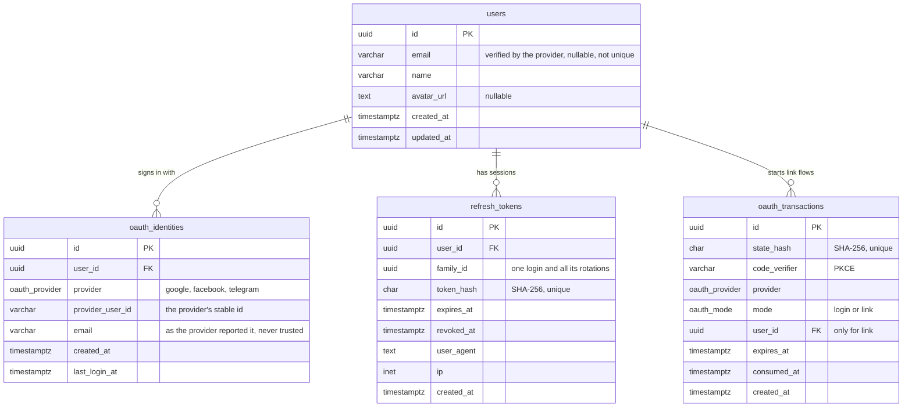

# Database

PostgreSQL. The migration `internal/db/migrations/00001_init.sql` (goose) is the source of truth and is embedded in the binary. [schema.dbml](schema.dbml) is the same schema in DBML, for tools like dbdiagram.io. The schema is identical to the NestJS version; only the way it is created differs.

## Model

## Why four tables

| Table | Holds | Why separate |
|---|---|---|
| `users` | the person | One row per person, independent of how they sign in |
| `oauth_identities` | one provider account | A person can have several, and each is identified by what the provider guarantees (`sub`, the Graph `id`), not by email |
| `refresh_tokens` | sessions | Revocation, rotation and reuse detection need a row per token |
| `oauth_transactions` | a flow in progress | `state` and the PKCE verifier must be single use and bound to one browser, which a signed cookie cannot guarantee |

## Constraints, and the rule each one enforces

The application relies on the database to be the final authority, so every rule that matters is a constraint, not just a check in code.

| Constraint | Rule | Used by |
|---|---|---|
| `uq_identity_provider_subject` unique `(provider, provider_user_id)` | A provider account belongs to at most one user | Decides concurrent first logins (the loser logs in the winner's user) and `identity_taken` |
| `uq_identity_user_provider` unique `(user_id, provider)` | A user has at most one account per provider | `already_linked` |
| `refresh_tokens.token_hash` unique | A token maps to one row | Lookup by hash |
| `oauth_transactions.state_hash` unique | A `state` maps to one flow | Lookup on callback |
| Foreign keys `ON DELETE CASCADE` | Deleting a user removes identities, tokens and transactions | No orphans, and a link flow dies with its user |
| Indexes on `refresh_tokens(user_id)` and `(family_id)` | Revoke a family, list a user's sessions | Reuse detection |

## Decisions

| Decision | Reason |
|---|---|
| `users.email` is nullable and **not unique** | It is filled only when the provider verified it (Google). A unique email would make Facebook and Telegram sign-ups collide or tempt the code into merging by email, which is the takeover this design avoids |
| The provider's raw email lives on `oauth_identities.email` | For reference only. It is never used to find or merge accounts |
| Hashes for refresh tokens and `state`, never the raw value | A database leak must not hand out working sessions |
| The PKCE `code_verifier` is stored in clear text | It is useless without the matching authorization code, and it only lives for ten minutes |
| No provider access tokens are stored | Login only. The service never calls a provider on a user's behalf |
| `uuid` keys with `gen_random_uuid()`, `timestamptz` everywhere | Keys that do not leak counts and time zones that cannot be misread |
| Snake case everywhere | Plain column names that any language or tool reads without a mapping layer |
| `name` and `avatar_url` live on `users`, not on the identity | One profile. The name is set at sign-up and never rewritten; the avatar follows the last login because provider picture links expire |
| One enum type each for the provider and the flow mode | The database rejects a provider the code does not know |

## Alternatives that were rejected

- **One `users` table with `google_id`, `facebook_id`, `telegram_id` columns.** Adding a provider becomes a migration, and a person's accounts cannot be listed uniformly.
- **A unique, case-insensitive email on `users`.** Looks tidy and invites account matching by email. It also breaks for Telegram, which has no email at all.
- **Provider tokens stored for later API calls.** Nothing needs them, and they would be secrets to protect.
- **Storing the profile as JSON.** Hard to constrain and to index, and nothing reads it.

## Lifecycle

- Migrations are applied by goose when the process starts with `MIGRATE_ON_START=true` (the container sets it). Each migration has an `Up` and a `Down` section. A rollback starts the previous image against the already migrated database, so migrations must stay backward compatible.
- `oauth_transactions` and expired `refresh_tokens` rows are **never deleted**. A load test wrote about 220,000 transaction rows in ten seconds, which shows the growth. A scheduled delete of expired rows is the first thing to add before this runs for long, and is listed in the README under known limits.
- `refresh_tokens.ip` is the `inet` type, so a malformed address is rejected by the database; the code only stores addresses that pass `net.isIP`.
